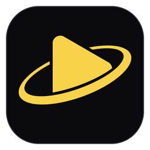
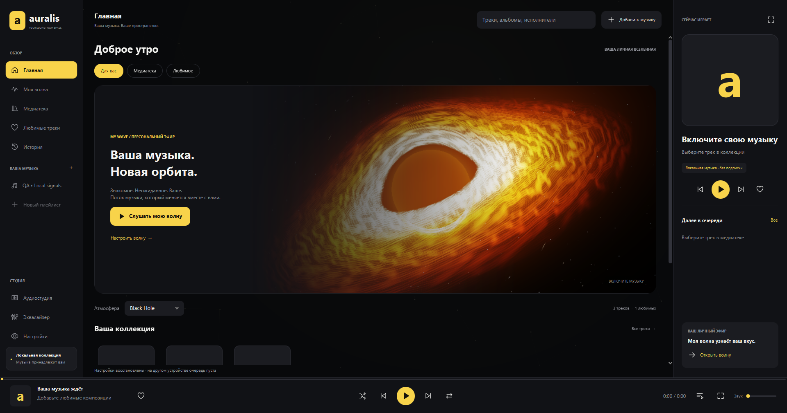
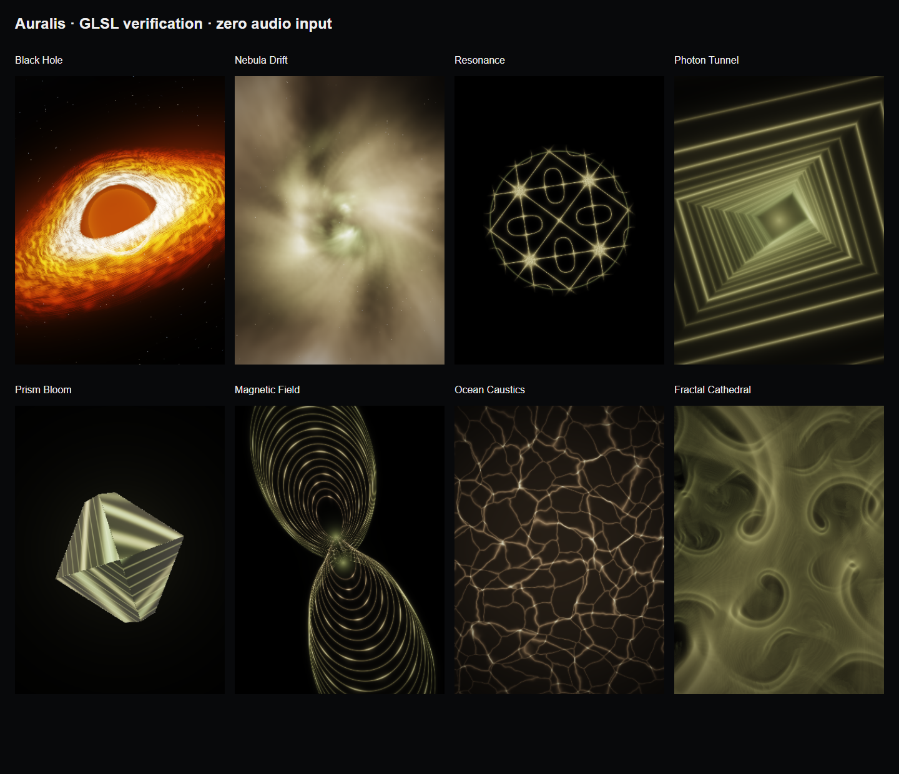
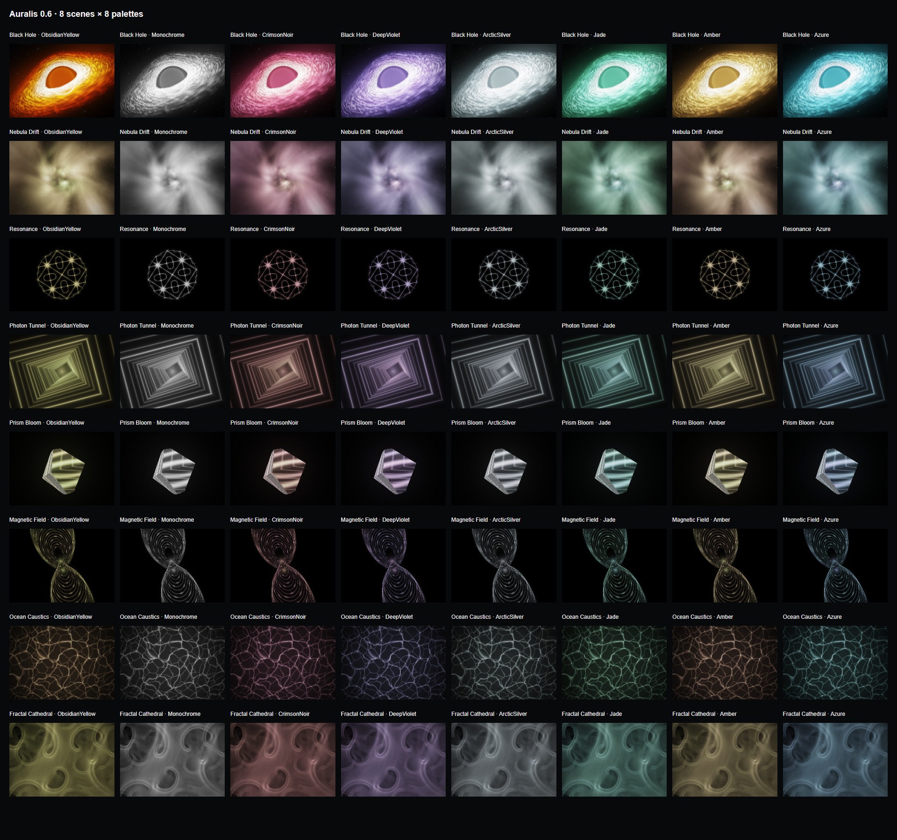
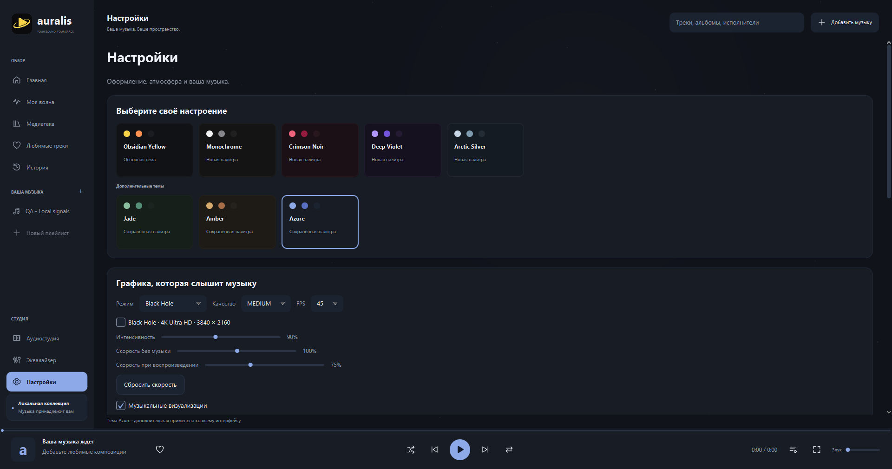
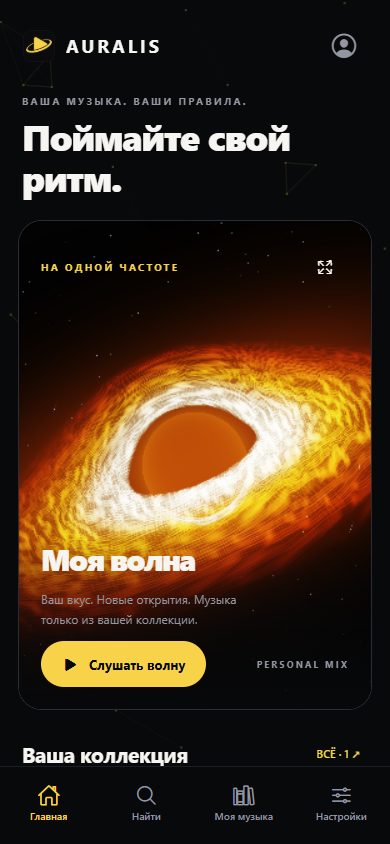

<div align="center">




# Auralis

### У каждой песни есть гравитация.

Ваша музыка. Ваше пространство. Ваша собственная вселенная.

**Музыкальная платформа для Windows, Linux и Android с личной библиотекой, собственным сервером и графикой, которая слышит звук.**

**Скачать:** [Windows EXE](https://github.com/Hollwestn/Auralis/releases/download/v0.6.2-preview/Auralis-Setup.exe) · [Android APK — Preview](https://github.com/Hollwestn/Auralis/releases/download/v0.6.2-preview/Auralis-Android-Test.apk) · [Сервер ZIP](https://github.com/Hollwestn/Auralis/releases/download/v0.6.2-preview/Auralis-Server-Internet.zip)

[Что скачать](docs/GITHUB_DOWNLOADS.md) · [Начать слушать](START_HERE.md) · [Без аккаунта](docs/MOBILE_OFFLINE_GUIDE.md) · [Свой сервер](docs/SERVER_INTERNET_GUIDE.md) · [Сборки](https://github.com/Hollwestn/Auralis/releases)




<sub>Интерфейс Desktop. Black Hole рендерится процедурно на GPU.</sub>

</div>

> **Исходники 0.8.0:** подготовлены Linux x86_64, профили сборки Google Play / RuStore / App Store, политика конфиденциальности и поддержка. [Короткий гайд](docs/RELEASE_GUIDE.md) · [Идеи развития](docs/NEXT_STEPS.md) · [Проверки и ограничения](docs/verification/STORE_LINUX_080.md). Это подготовка к публикации; готовые файлы прежних выпусков ниже имеют собственные номера версий. Подписанный IPA и магазинный AAB ещё не выпущены.

**Локальное обновление 0.7.0:** исправлены обложки, добавлены таймер сна и автоматические подборки. [Отчёт и установка](docs/UPDATE_070.md).

## Нажмите Play. Остальное почувствуете.

Тёмный экран, тёплый свет, знакомая композиция. Аккреционный диск медленно движется в пространстве. Вступает бас — по сцене проходит световой импульс. Музыка становится частью интерфейса.

Auralis соединяет этот визуальный опыт с повседневными вещами: вашей папкой с музыкой, любимыми треками, плейлистами, поиском и продолжением прослушивания. На компьютере можно работать с локальными файлами. На телефоне — выбрать режим без аккаунта и добавить музыку из памяти устройства. Для общей коллекции на разных устройствах предусмотрен собственный сервер.

Здесь нет встроенного коммерческого каталога. Вы выбираете, что слушать и где хранить свою музыку.

## Графика, которая слышит музыку

Визуализации получают характеристики воспроизводимого аудио. Бас, частотные полосы и резкие изменения сигнала управляют светом и движением. Это реакция на ваш трек.

| Сцена | Характер |
|---|---|
| **Black Hole** | Объёмный аккреционный диск, глубокая тень, свет и музыкальные вспышки |
| **Nebula Drift** | Светящиеся космические облака |
| **Resonance** | Структуры, собранные вокруг резонанса и ритма |
| **Photon Tunnel** | Световой тоннель с ощущением глубины |
| **Prism Bloom** | Призматические формы и цветовое раскрытие |
| **Magnetic Field** | Текучая геометрия силового поля |
| **Ocean Caustics** | Переливы света и водная пластика |
| **Fractal Cathedral** | Фрактальная архитектура света |

Отдельная скорость при музыке и в паузе, интенсивность, качество, FPS, уменьшение движения и отключение эффектов доступны в настройках. Black Hole поддерживает отдельный режим рендера **3840 × 2160** на Desktop; телефон использует адаптивное разрешение.

<details>
<summary><strong>Посмотреть сцены и палитры</strong></summary>





</details>

## Свой звук — свой способ слушать

| Windows | Android | Личный сервер |
|---|---|---|
| Локальная медиатека и поиск | Режим без регистрации | Общая коллекция для ваших устройств |
| Плейлисты, избранное, история | Импорт собственных аудиофайлов | Аккаунты и отдельные библиотеки |
| «Моя волна» | Локальные плейлисты и избранное | Потоковое воспроизведение |
| Десятиполосный эквалайзер | Нативный плеер и очередь | Синхронизация состояния |
| Неразрушающий монтаж через FFmpeg | Поиск, история и локальная волна | PostgreSQL, Docker и HTTPS |
| GPU-графика и режим 4K | Темы и GPU-визуализации | Доступ из разных сетей |

Локальная библиотека Mobile появилась в **0.6.2**. APK собран и установлен; полный сценарий импорта и воспроизведения этой новой функции на физическом устройстве пока ожидает завершения проверки. Предыдущая 0.6.1 проверена на Samsung S21: вход, серверная музыка и восемь GPU-сцен. [Точные результаты](docs/MOBILE_TEST_REPORT.md).

## Цвет — часть атмосферы

**Obsidian Yellow** · **Monochrome** · **Crimson Noir** · **Deep Violet** · **Arctic Silver**

Глубокий чёрный, насыщенные акценты, спокойная типографика и свет, подчинённый выбранной палитре. Дополнительные **Jade**, **Amber** и **Azure** сохранены. Темы распространяются на интерфейс и визуализации.

<table><tr>
<td width="72%"></td>
<td width="28%"></td>
</tr></table>

## Начать с музыки

**Windows.** Установите сборку из [Releases](https://github.com/Hollwestn/Auralis/releases) либо соберите её из исходников. Выберите музыкальную папку и включите первый трек. Для локального прослушивания сервер не нужен. [Установка и обновление →](docs/WINDOWS_INSTALLATION.md)

**Linux.** Для Ubuntu 24.04 x86_64 подготовлен DEB и проверен запуск установленного приложения. [Пакет и руководство →](docs/RELEASE_GUIDE.md)

**Android.** Установите APK, нажмите **«Продолжить без аккаунта»**, затем **«Добавить музыку с телефона»**. Выбранные файлы копируются во внутреннее хранилище. [Пошаговая инструкция →](docs/MOBILE_OFFLINE_GUIDE.md)

**Несколько устройств.** Поднимите свой сервер, укажите один HTTPS-адрес на компьютере и телефоне, войдите в общий аккаунт и загрузите собственную музыку. Для VPS общая Wi-Fi-сеть не нужна. [VPS, домен и HTTPS →](docs/SERVER_INTERNET_GUIDE.md)

## Под капотом

| Слой | Технологии и исходники |
|---|---|
| Desktop | Java 25, JavaFX, LWJGL, OpenGL · `apps/desktop` |
| Audio core | SQLite, FFmpeg/FFprobe, библиотека и монтаж · `audio/core` |
| Mobile | React Native, Expo SDK 58, TypeScript, нативное аудио · `apps/mobile` |
| Graphics | Процедурные GLSL-сцены, PCM/спектр · `shared/visuals` |
| Backend | Spring Boot, PostgreSQL, Flyway, HTTP Range · `backend/server` |
| Deployment | Docker Compose, Caddy, HTTPS · `infrastructure` |

Desktop и сервер: JDK 25, Maven 3.9+, FFmpeg/FFprobe. Windows-установщик дополнительно требует WiX 3.

```powershell
mvn -B verify
.\scripts\build-desktop.ps1 -Type exe
```

Мобильный клиент: Node 24, для Android — JDK 17/21 и Android SDK. На Windows используйте короткий путь без кириллицы.

```powershell
cd apps/mobile
npm ci
npm run lint
npm run typecheck
npm test
cd ../..
.\scripts\build-android.ps1 -AllowLocalHttp
```

`-AllowLocalHttp` нужен для тестового подключения к локальному серверу. Публичный сервер использует HTTPS. Подробности: [Desktop](docs/DEVELOPMENT_GUIDE.md), [Android](docs/ANDROID_INSTALLATION.md), [iOS](docs/IOS_INSTALLATION.md).

## Красота, которую можно проверить

Для Desktop 0.6.1 прошли **55 Java-тестов** и **44 проверки интерфейса**. Для Mobile 0.6.2 прошли **17 Node-тестов**, TypeScript, ESLint и **3 нативных PCM-теста**; собран Android APK и экспортированы Android/iOS-бандлы.

Готовность, ограничения и результаты запуска описаны в [отчёте](TEST_REPORT.md). iOS представлен исходниками: IPA требует Mac и подписи. Мобильные EQ и монтаж пока не реализованы. Режим 4K зависит от GPU и не означает гарантированные 60 FPS.

## Документация

[Первый запуск](START_HERE.md) · [Библиотека](docs/MUSIC_LIBRARY_GUIDE.md) · [Моя волна](docs/MY_WAVE_GUIDE.md) · [Студия](docs/ADVANCED_MODE_GUIDE.md) · [Архитектура](ARCHITECTURE.md) · [Планы](ROADMAP.md) · [Сторонние компоненты](docs/THIRD_PARTY_NOTICES.md)

---

<div align="center">

**Auralis — музыка, которой вы задаёте пространство.**

YOUR SOUND. YOUR SPACE.

</div>
