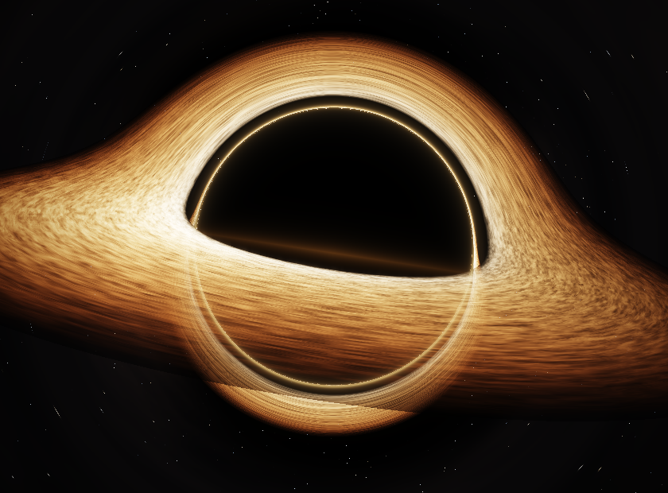
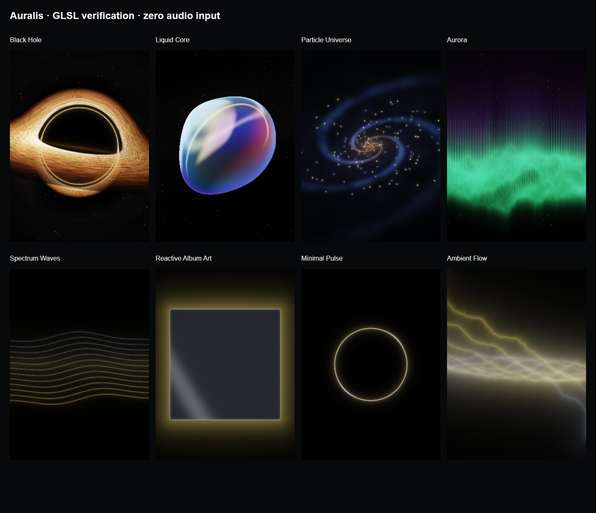

> Исторический протокол. Текущая версия0.5.0: [Black Hole3D /4K](BLACK_HOLE_4K.md).

# Проверка новой графики Auralis 0.3.0

Исторический протокол0.3.0. Текущее изменение Black Hole0.3.1: [CLASSIC_BLACK_HOLE.md](CLASSIC_BLACK_HOLE.md).

18 октября 2026. Полная замена прежних простых мешей общим процедурным GPU-рендером Desktop/Android/iOS. Фактические сцены, алгоритмы и ограничения: [архитектура](VISUALIZATION_ARCHITECTURE.md).



## Выполненные проверки

- Maven verify:52 теста,0 ошибок/пропусков. Desktop UI:39 проверок библиотеки, воспроизведения, редактора, волны, плейлистов, тем и минимального окна.
- Поставляемый JAR исполнен на NVIDIA RTX3050 / OpenGL3.3. Все8 сцен нарисовали непустой кадр и получили настоящий спектр MediaPlayer. Использован изолированный синтезированный WAV55/440/4400Hz,48kHz, с амплитудной модуляцией; громкость0. Это проверка сигнала/декодирования без субъективного прослушивания.
- LOW/HIGH действительно меняет framebuffer:130200/520800 пикселей при окне840×620. Записанные единичные значения времени GPU-прохода **вместе с readback**: 1.14–3.98ms. Это не средний FPS, не профиль на слабом ПК и не измерение телефона.
- Смена нескольких режимов на паузе сохраняет последний выбор; выключенные эффекты/сворачивание не продолжают цикл. Reduced motion уложился в14 обновлений за800ms.
- Проверена загрузка асинхронно декодированной оригинальной текстуры: красная/синяя половины изолированной тестовой обложки правильно попадают в Reactive Album Art. В продукт тестовая обложка не включена.
- Клик не меняет замороженный кадр; курсор не вращает камеру.
- Явный software fallback проверен отдельно,8 непустых спектральных кадров. Он не выдаётся за кинематографические сцены.
- Mobile: ESLint/TypeScript без ошибок;9 Node-тестов;2 JVM-теста настоящего PCM-процессора Android.
- Общий GLSL проверен в WebGL:8 режимов ×3 качества ×2 фактических размера framebuffer =48 вариантов. Для каждого режима также проверены аудио/бас, нулевая интенсивность, отсутствие click/drag-эффектов и Monochrome.
- Мобильный UI проверен с реальным локальным API:5 сценариев,0 ошибок страницы. [Главная телефона](verification/mobile-home.png).
- Windows portable и извлечённый MSI0.3.0 запущены с комплектными Java/FFmpeg/OpenGL natives. Все13 основных файлов совпали по SHA; лог подтвердил настоящий запуск OpenGL. Три условия защиты миграции MSI прошли, установленная пользовательская программа не менялась.
- Автономный Android APK0.3.0/code3,arm64,Android7+,подпись APKv2 и16KiB alignment проверены. 32 исходника совпали с приватной сборкой; source map настоящего APK проверила6 последних визуальных файлов. Кодовая часть Hermes совпала с отдельным Android export; отличаются40 байт заголовка/контрольной суммы.

Физического Android-телефона/эмулятора нет: звук PCM→JS на устройстве, драйвер GPU, FPS, энергопотребление и фоновые сценарии телефона не объявляются проверенными. iOS Hermes экспорт создан, Xcode/Swift/IPA на Windows не собирались. Публичный VPS этим обновлением не разворачивался.

## Кадры поставляемого JAR

| Режим | Контрастных проб | Изображение |
|---|---:|---|
| black_hole | 11141 | [Кадр](verification/cinematic/black_hole.png) |
| liquid_core | 3266 | [Кадр](verification/cinematic/liquid_core.png) |
| particle_universe | 16717 | [Кадр](verification/cinematic/particle_universe.png) |
| aurora | 18717 | [Кадр](verification/cinematic/aurora.png) |
| spectrum_waves | 10736 | [Кадр](verification/cinematic/spectrum_waves.png) |
| reactive_album_art | 19067 | [Кадр](verification/cinematic/reactive_album_art.png) |
| minimal_pulse | 6472 | [Кадр](verification/cinematic/minimal_pulse.png) |
| ambient_flow | 19175 | [Кадр](verification/cinematic/ambient_flow.png) |
| black-hole-low-detail | 10439 | [Кадр](verification/cinematic/black-hole-low-detail.png) |
| black-hole-high-detail | 11053 | [Кадр](verification/cinematic/black-hole-high-detail.png) |
| animations-off-static-aurora | 18681 | [Кадр](verification/cinematic/animations-off-static-aurora.png) |



Пробы подтверждают непустой кадр и не являются FPS. Обложка в QA-кадре — специально созданный красно-синий тестовый рисунок.

## Свидетельства и повторение

[Сводный JSON](verification/cinematic.json), [GPU](verification/cinematic/gpu.log), [fallback](verification/cinematic/fallback.log), [mobile shaders](verification/cinematic-shaders.json), [APK](verification/android-apk.json), [MSI](verification/windows-msi.json), [SHA поставки](../release/SHA256SUMS.txt).

Проверить единый исходник: `node scripts/sync-visuals.mjs --check`. После Maven verify:

```powershell
java --enable-native-access=ALL-UNNAMED '-Dauralis.visualTestDirectory=.runtime/cinematic-check' -cp 'apps/desktop/target/test-classes;apps/desktop/target/auralis-desktop-0.1.0-SNAPSHOT.jar;apps/desktop/target/lib/*' 'io.auralis.desktop.visualization.VisualizationSmokeHarness$Launcher'
```

Для явного fallback добавьте `-Dauralis.graphics.software=true -Dprism.order=sw` и другой каталог внутри .runtime. Мобильные команды приведены в MOBILE_TEST_REPORT.md; эталонные окна проверяются `apps/mobile/scripts/verify-shaders.mjs`.

SHA-256 общего GLSL: `03BDEB94764C9A01102747589AF881A7E091C6EA85F8BD7061748DE5AECEA29C`. Точное совпадение канонического `.frag` внутри поставляемого Desktop JAR и сгенерированного мобильного модуля проверено.
