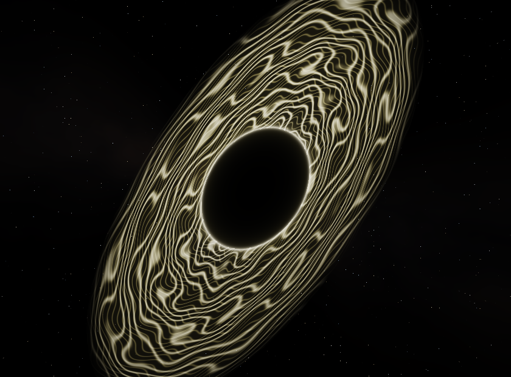

> Исторический протокол. Текущая версия0.5.0: [Black Hole3D /4K](BLACK_HOLE_4K.md).

# Black Hole0.3.1 — первоначальный вид и световые вспышки

По просьбе пользователя восстановлена исходная композиция: наклонённый тонкий диск, чёрный центр и волнистые световые нити. Формула нитей перенесена из архивной ранней сборки проекта в общий GLSL. Ray-marching образ из0.3.0 заменён. Современный общий рендер Desktop/Mobile сохранён.

Размер карточек510px на ПК и490px на телефоне, масштаб/zoom и размещение сцены сохранены. В Black Hole музыка больше не расширяет и не деформирует геометрию. Музыкальные атаки вызывают только вспышки свечения; от часов/мыши/касания они не генерируются. Desktop использует измеренный onset спектра; Mobile — положительный спектральный поток и атаки баса/RMS, затухание180ms. Длительный ровный звук не запускает бесконечные вспышки.

## Проверено

- Maven verify:52 теста; Mobile ESLint/TypeScript;10 Node-тестов, включая вспышку от атаки, затухание при удержании тона и отсутствие эффекта при паузе/устаревшем сигнале.
- WebGL:8 сцен ×3 качества ×2 фактических framebuffer =48 вариантов. Black Hole: изменение от баса без onset **0**, изменение от вспышки **5136065** суммарных RGB-единиц. Это сравнение кадров, не FPS.
- Остальные7 режимов сохранили точные контрольные значения исходного кадра, реакции на бас и общие аудиоданные из протокола0.3.0.
- Поставляемый Windows JAR нарисовал8 непустых сцен с настоящим MediaPlayer/спектром. Проверены обложка после асинхронной загрузки, быстрая смена режима на паузе, отсутствие click-эффекта, прекращение цикла при отключении/сворачивании.
- Portable/MSI0.3.1 запущены с комплектными Java/FFmpeg/OpenGL natives;13 основных файлов совпали. Установленная программа пользователя не изменялась.
- Автономный APK0.3.1/code4: arm64,Android7+,проверенная тестовая APKv2-подпись и16KiB alignment;2 настоящих PCM unit-теста.32 исходника совпали с приватной сборкой. Source map фактического APK подтвердила7 файлов, включая новый анализ вспышек и общий шейдер; кодовая область Hermes совпала с отдельным экспортом.

Физический Android/iPhone не подключался. FPS, батарея и настоящий PCM→JS на телефоне не заявляются проверенными. iOS Hermes экспорт создан, IPA требует Mac/Xcode. Сервер и API в этом изменении не затрагивались.

Свидетельства: [JSON](verification/classic.json), [GPU](verification/classic/gpu.log), [шейдеры](verification/classic-shaders.json), [APK](verification/android-apk.json), [MSI](verification/windows-msi.json), [контрольные суммы](../release/SHA256SUMS.txt).

Общий GLSL SHA-256: `6E548665DE73AE574AA980346CBF32C13AC9945010D3649FDE6F42C53EECC4D3`. Проверка единого источника: `node scripts/sync-visuals.mjs --check`.
